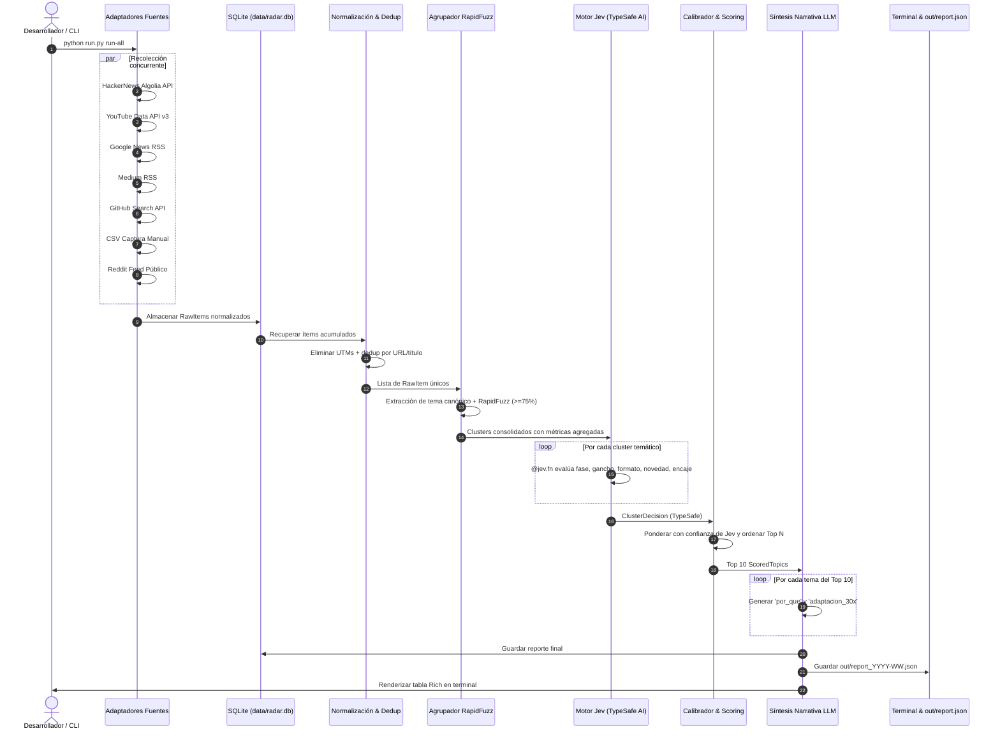

# 🏛️ Arquitectura Técnica Detallada — Radar30X

Este documento describe la arquitectura interna, contratos de datos, flujo de ejecución y consideraciones de ingeniería del **Radar de Contenido 30X**.

---

## 1. Principios de Diseño

1. **Un proceso, un comando:** Cero dependencias de microservicios pesados (Celery, Redis, Docker o Postgres). La base de datos es SQLite embebida.
2. **Separación estricta entre Decisión y Redacción:**
   - **Decisión:** Jev (TypeSafe AI) produce valores estructurados y probabilidades calibradas sin alucinación.
   - **Redacción:** LLM económico (o templates deterministas) redacta la narrativa editorial sobre los tipos ya decididos.
3. **Determinismo y Resiliencia:** Cada paso del pipeline cuenta con validación de tipos Pydantic, manejo de excepciones por fuente y mecanismos de fallback.

---

## 2. Diagrama de Flujo de Datos



---

## 3. Contratos de Datos (Modelos Pydantic)

### 3.1. `RawItem` (Capa de Ingesta)
```python
class RawItem(BaseModel):
    id: str                   # Hash canónico de la URL o ID de origen
    fuente: str               # Nombre del origen ("HackerNews", "YouTube", etc.)
    titulo: str               # Título de la pieza
    resumen: str              # Extracto o descripción pública
    url: str                  # URL canónica sin parámetros de rastreo
    autor: str                # Nombre o usuario del creador
    fecha: str                # Fecha en formato ISO 8601
    metricas: Dict[str, Any]  # Métricas cuantitativas (vistas, puntos, estrellas, etc.)
```

### 3.2. `TopicCluster` (Capa de Agrupamiento)
```python
class TopicCluster(BaseModel):
    cluster_id: str
    tema_canonico: str
    items: List[RawItem]
    fuentes: List[str]
    total_menciones: int
    metricas_agregadas: Dict[str, Any]
```

### 3.3. `ClusterDecision` (Salida de Jev / TypeSafe)
```python
class ClusterDecision(BaseModel):
    fase: Literal["naciendo", "en_crecimiento", "saturado"]
    gancho: Literal["dato_contraintuitivo", "opinion", "tutorial", "contraste", "historia"]
    formato: Literal["hilo", "carousel", "video_corto", "long_form", "articulo"]
    novedad: float = Field(ge=0.0, le=1.0)
    encaje_audiencia: float = Field(ge=0.0, le=1.0)
    confianza: float = Field(ge=0.0, le=1.0)
```

---

## 4. Agrupamiento con RapidFuzz

Para evitar la complejidad de bases vectoriales, GPUs o microservicios de embeddings durante una competencia de 24 horas, Radar30X utiliza un enfoque algorítmico determinista con `rapidfuzz`:

1. **Limpieza Canónica:** Se eliminan prefijos ruidosos (`Show HN:`, `[Tutorial]`, `#Shorts`, etc.).
2. **Cálculo de `token_set_ratio`:**
   $$\text{similitud}(T_1, T_2) = \text{token\_set\_ratio}(T_1, T_2)$$
   Si $\text{similitud} \ge 75\%$, el ítem se asocia al cluster existente; si no, se crea un nuevo cluster.
3. **Consolidación de Señales:** Cada cluster agrega las métricas cuantitativas de todos sus ítems (vistas/hora, puntos totales, diversidad de fuentes).

---

## 5. Esquema de Base de Datos SQLite

El archivo `data/radar.db` contiene cuatro tablas relacionales optimizadas con índices:

- **`items`:** Registro histórico de piezas recolectadas, con restricción `UNIQUE` en la columna `url`.
- **`clusters`:** Temas agrupados y su consolidación de fuentes.
- **`decisions`:** Decisiones tipadas producidas por Jev con clave foránea a `clusters`.
- **`reports`:** Almacenamiento JSON de cada reporte generado para consultas históricas y seguimiento de evolución temporal.
