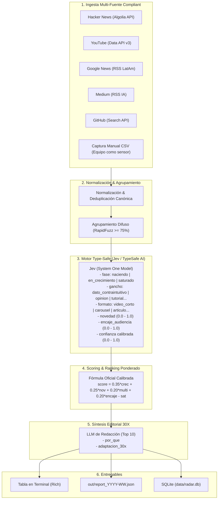

# 📡 Radar de Contenido 30X

> **Descubrimiento confiable, type-safe y de bajo costo de tendencias en Inteligencia Artificial para líderes y equipos en Latinoamérica.**

Proyecto desarrollado para el **Hackathon Reto 30X — "Radar de contenido"** (Área: Media · 24h · 1 Dev).  
🌐 **Plataforma en vivo:** [https://sonar.perte.design](https://sonar.perte.design)  
📖 **Documentación Técnica Completa:** Consulta [DOCUMENTACION.md](DOCUMENTACION.md) para la arquitectura detallada, herramientas, estado de secciones, roadmap y gotchas.

---

## 1. El Problema & La Oportunidad

Hoy en día, las empresas y equipos de contenido sobre Inteligencia Artificial dependen de servicios de scraping opacos y costosos (miles de dólares al año). Estas herramientas tradicionales:
- **Traen datos brutos sin contexto:** no explican *por qué* funciona una publicación.
- **No distinguen el ciclo de vida:** confunden una tendencia naciente con un tema copiado o saturado.
- **Ignoran el encaje de audiencia:** no evalúan si el contenido resuena con directivos o profesionales corporativos en LatAm.
- **Riesgo legal:** con frecuencia dependen de técnicas de scraping que violan los Términos de Servicio (ToS) de redes sociales.

### Pregunta que responde este proyecto:
> *"¿Cuáles son los 10 temas de IA que más están creciendo esta semana, por qué funcionan y cómo los adaptamos a la audiencia de 30X?"*

---

## 2. La Propuesta de Valor: Arquitectura Híbrida

El núcleo del diseño es una separación estricta de responsabilidades entre el razonamiento de decisiones y la generación creativa:

> **Jev DECIDE (confiable, calibrado, a escala) · El LLM REDACTA (donde la creatividad importa)**



---

## 3. Características Principales

1. **Decisiones Type-Safe con Jev (`typesafe.ai`):**
   - Utiliza el decorador `@jev.fn` y validación estricta con Pydantic.
   - Jev no genera strings libres; responde preguntas tipadas con **probabilidades calibradas**.
   - Cero riesgo de alucinación en tipos y clasificaciones críticas.
   - Costo ínfimo: **$0.042 por millón de tokens de entrada; salida gratis**.
   - Cuenta con un motor de respaldo determinista y calibrado para ejecución offline/test sin romper el pipeline.

2. **100% Compliant y Libre de Scraping Agresivo:**
   - Cero scraping con login o saltándose `robots.txt`.
   - APIs oficiales y feeds RSS públicos abiertos.
   - Enfoque de *"la comunidad y el equipo como sensor"* para capturar señales públicas de LinkedIn, Instagram y TikTok mediante CSV asistido.

3. **Arquitectura Ultra-Ligera (Un Proceso, Cero Infraestructura Costosa):**
   - Python 3.11+ puro, SQLite local, `httpx`, `rapidfuzz` y `rich`.
   - Sin Redis, sin Celery, sin Docker obligatorio, sin Postgres.
   - Todo el pipeline ejecuta en **menos de 30 segundos**.

---

## 4. Fuentes de Contenido

| Orden | Fuente | Método | Requiere Key | Qué aporta al radar |
|---|---|---|---|---|
| 1 | **Hacker News** | Algolia Search API (`search_by_date`) | No | Señales tempranas de desarrolladores y debates tech en tiempo real |
| 2 | **YouTube** | Data API v3 (search + videos) | Opcional | **Única fuente cuantitativa de formato** (vistas/hora, shorts vs long form) |
| 3 | **Google News** | RSS (`news.google.com/rss`) | No | Actualidad corporativa en español y cobertura LatAm |
| 4 | **Newsletters** | Feeds RSS (*The Rundown*, *Startups LatAm*, *Rest of World*) | No | Curaduría ejecutiva de alto nivel y señales de inversión/startups |
| 5 | **Hugging Face** | Hub Trending Models & Daily Papers API | No | **Tracción de modelos open-source** y papers más votados por la comunidad |
| 6 | **Medium** | RSS (`/feed/tag/artificial-intelligence`) | No | Artículos de análisis profundo y casos de adopción |
| 7 | **GitHub** | Search API (`topic:ai created:>14d`) | No | Nuevas herramientas y frameworks adoptados velozmente |
| 8 | **Manual CSV** | Captura asistida (`data/manual.csv`) | No | Señales de LinkedIn/TikTok/IG de forma 100% legal |
| 9 | **Reddit** | API pública / OAuth | Opcional | Señal de discusión comunitaria y saturación de debate |

---

## 5. Instalación Rápida

### Requisitos:
- Python 3.11 o superior (probado en Python 3.12 y 3.14).

```bash
# 1. Clonar o ingresar a la carpeta del proyecto
cd radar30x

# 2. Crear y activar entorno virtual
python3 -m venv .venv
source .venv/bin/activate

# 3. Instalar dependencias
pip install -r requirements.txt

# 4. (Opcional) Configurar credenciales
cp .env.example .env
# Edita .env con tus claves de TypeSafe AI, YouTube o LLM si las tienes.
```

> [!NOTE]
> Si no configuras claves en `.env`, el sistema funciona de manera autónoma con adaptadores públicos y el motor de decisión calibrado de respaldo.

---

## 6. Uso del CLI

### Ejecución de punta a punta:
```bash
python run.py run-all --top 10
```
Ejecuta la ingesta de las 7 fuentes, deduplica, agrupa temas en clusters, calcula decisiones con Jev, evalúa el ranking y muestra la tabla enriquecida en terminal, guardando el reporte en `out/report_YYYY-WXX.json`.

### Comandos individuales:
```bash
# 1. Solo recolectar contenido de fuentes públicas
python run.py ingest

# 2. Procesar agrupamiento y calcular decisiones Jev
python run.py score

# 3. Generar el reporte del Top 10 con síntesis editorial
python run.py report --top 10

# 4. Modo Demostración en Vivo (Dataset precalculado de respaldo)
python run.py demo
```

---

## 7. Ejemplo de Salida en Terminal

```
🎯 RADAR DE CONTENIDO 30X — TOP 10 TENDENCIAS DE IA
╭┬────────────────────────────────┬────────┬──────┬┬─┬───────┬─────────────────╮
││ TEMA                           │ FASE   │ CRE… ││ │ FORM… │ FUENTES         │
├┼────────────────────────────────┼────────┼──────┼┼─┼───────┼─────────────────┤
││ Agentes de IA con memoria      │ nacie… │ +38… ││ │ vide… │ HackerNews,You… │
││ Reemplazo de dashboards BI por │ nacie… │ +34… ││ │ caro… │ LinkedIn,Googl… │
││ Modelos pequeños calibrados    │ en_cr… │ +29… ││ │ arti… │ HackerNews,Lin… │
││ Cumplimiento normativo RRHH    │ nacie… │ +26… ││ │ caro… │ LinkedIn,Googl… │
││ Automatización prospección B2B │ en_cr… │ +31… ││ │ vide… │ YouTube,TikTok… │
╰┴────────────────────────────────┴────────┴──────┴┴─┴───────┴─────────────────╯

╭────────── #1 Agentes de IA con memoria persistente y bases locales ──────────╮
│ → Por qué: Dato contraintuitivo que demuestra cómo la memoria local reduce   │
│ costos de API en 80%; pico de 540 vistas/hora en YouTube y adopción          │
│ acelerada en GitHub.                                                         │
│ → Adaptación 30X: Reel/Short: 'Por qué tu empresa está gastando de más en    │
│ APIs: Agentes con memoria local explicados en 60s' + carrusel con checklist  │
│ en LinkedIn.                                                                 │
╰──────────────────────────────────────────────────────────────────────────────╯
```

Y en `out/report_2026-W42.json`:
```json
{
  "semana": "2026-W42",
  "generado": "2026-10-16T23:15:57Z",
  "top_temas": [
    {
      "posicion": 1,
      "tema": "Agentes de IA con memoria persistente y bases locales",
      "fase": "naciendo",
      "confianza_jev": 0.92,
      "crecimiento": "+385% vs semana previa",
      "score": 0.884,
      "fuentes": ["HackerNews", "YouTube", "GitHub", "Manual (LinkedIn)"],
      "gancho": "dato_contraintuitivo",
      "formato": "video_corto",
      "encaje_audiencia": 0.94,
      "por_que": "Dato contraintuitivo que demuestra cómo la memoria local reduce costos de API en 80%...",
      "adaptacion_30x": "Reel/Short: 'Por qué tu empresa está gastando de más en APIs: Agentes con memoria local explicados en 60s' + carrusel en LinkedIn.",
      "evidencia": ["https://news.ycombinator.com/item?id=3891024", "https://www.youtube.com/watch?v=..."]
    }
  ]
}
```

---

## 8. Fórmula Matemática de Scoring

El ranking se calcula combinando métricas cuantitativas y cualitativas, ponderadas por la **confianza calibrada de Jev**:

$$\text{score} = \text{confianza} \times (0.35 \times \text{crecimiento} + 0.25 \times \text{novedad} + 0.20 \times \text{multifuente} + 0.20 \times \text{encaje}) - \text{saturación}$$

- **Crecimiento ($35\%$):** Normalizado según el ratio de vistas/hora en YouTube y aceleración de menciones.
- **Novedad ($25\%$):** Probabilidad evaluada por Jev de que la discusión tenga menos de 7 días.
- **Multifuente ($20\%$):** Dispersión entre plataformas independientes (si está en HN + YouTube + LinkedIn, la señal es sólida).
- **Encaje de Audiencia ($20\%$):** Probabilidad calibrada de relevancia directa para directores, gerentes y equipos en Latinoamérica.
- **Saturación (penalización):** Si Jev detecta que el tema ya está copiado o agotado, resta puntaje para no recomendar temas quemados.

---

## 9. Análisis de Costo Real (< $1 USD)

| Componente | Uso estimado (Hackathon 24h) | Costo unitario | Total |
|---|---|---|---|
| **Fuentes (APIs & RSS)** | 500+ peticiones (Algolia, Google, GH) | $0.00 | **$0.00** |
| **Jev (TypeSafe AI)** | ~100 clusters evaluados (~200k tokens in) | $0.042 / MTok (Output gratis) | **~$0.01** |
| **LLM de Redacción** | 10 llamadas Top 10 (Haiku / 4o-mini / DeepSeek) | $0.15 / MTok | **~$0.02** |
| **Infraestructura** | SQLite local (0 servidores externos) | $0.00 | **$0.00** |
| **TOTAL** | — | — | **< $0.05 USD** |

---

## 10. Ejecución de Pruebas Unitarias

```bash
pytest -o cache_dir=/tmp/pytest_cache tests
```
Toda la suite incluye 12 pruebas automatizadas que cubren:
- Normalización y limpieza de URLs de rastreo.
- Agrupamiento de temas con `rapidfuzz`.
- Validación type-safe de esquemas `ClusterDecision`.
- Calibración determinista del motor de respaldo.
- Cálculo de la fórmula de scoring y ordenamiento.
